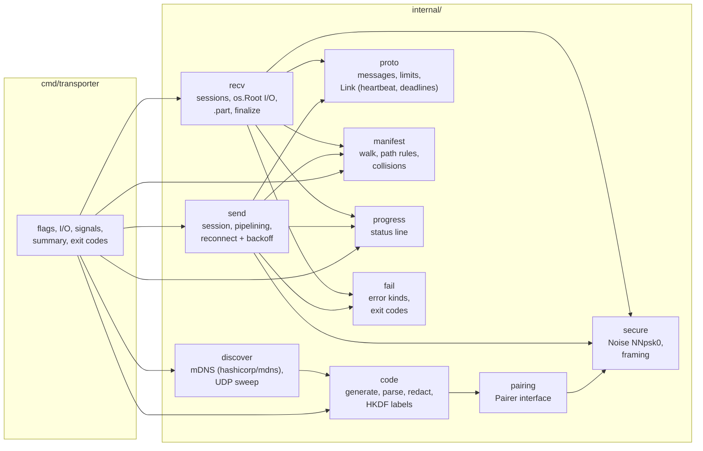

# Architecture

This document describes how Transporter is put together (DOC-2). The wire
format is in [protocol.md](protocol.md), the security design in
[security.md](security.md), and the reasoning behind choices in
[DECISIONS.md](DECISIONS.md).

## 1. Components



| Package | Responsibility |
| --- | --- |
| `cmd/transporter` | Command-line parsing (cobra) and the optional YAML config file of defaults, code input (CODE-8), wiring, signal handling, summaries, exit codes. No transfer logic. |
| `internal/code` | The word list, code generation and lenient parsing, the redacting `Code` type, and HKDF derivation of the PSK and discovery tag. |
| `internal/pairing` | The `Pairer` interface (how the handshake secret is obtained) and the code-based implementation. |
| `internal/secure` | Noise NNpsk0 handshake and the length-prefixed encrypted frame connection. |
| `internal/proto` | Message types, their binary encoding, protocol limits, and `Link`, which adds heartbeats and read/write deadlines on top of any frame connection. |
| `internal/manifest` | Walking local sources into entries, wire-path validation, Windows name rules, collision detection. |
| `internal/send` | The sender session: manifest streaming, NEED handling, pipelined file sending, the retry loop. |
| `internal/recv` | The receiver: accept loop, authentication, session supersession and BUSY, manifest validation, the NEED planner, the per-file state machine, finalization. All destination I/O goes through `os.Root`. |
| `internal/discover` | mDNS advertising and browsing, and the UDP unicast sweep that is the fallback when mDNS finds nothing, both behind the `Advertiser` and `Browser` interfaces. |
| `internal/progress` | Thread-safe counters and the stderr renderer (TTY or plain). |
| `internal/fail` | Error kinds (transient vs fatal), user-facing messages and hints, exit codes and their precedence. |
| `internal/hashpipe` | Runs a hash on a helper goroutine so hashing overlaps with encryption and disk writes (NFR-3). |
| `internal/meta` | The project name (the one place it appears in code) and version. |
| `internal/testutil` | Test support: fault-injecting connection, TCP proxy, tree builders and comparison, goroutine leak check. |

Transfer logic depends only on `net.Conn` and the `proto.FrameConn`
interface, so it runs unchanged over `net.Pipe`, fault-injecting wrappers
and real TCP (DEL-3).

## 2. Data flow

### Sender

1. `manifest.Walk` lists the sources once, before connecting. Symlinks and
   special files are skipped with warnings, names that cannot go on the
   wire are skipped, unreadable directories become per-file errors, and the
   receiver's own checks (limits, collisions) run locally so problems show
   up before any network activity.
2. For each connection attempt: dial, `secure.Client` (handshake),
   `proto.NewLink`, HELLO, then the manifest in frame-sized batches.
3. A reader goroutine records NEED records and ACKs. The main goroutine
   walks the entries in order: for SEND it opens the file, checks size and
   mtime, hashes any prefix the receiver already has, and streams chunks
   read directly into the frame buffer.
4. After everything is acknowledged: DONE, wait for the receiver's DONE,
   close.

### Receiver

1. `recv.New` creates the destination if needed, opens it as an `os.Root`,
   and probes that it is writable.
2. The accept loop takes a slot (at most 4 unauthenticated connections),
   accepts, and runs `secure.Server`.
3. HELLO decides between serving, superseding the session's previous
   connection, or BUSY.
4. Manifest entries are validated one by one (`manifest.Checker`).
5. The planner goroutine decides each entry: pass 1 (lstat, mkdir, quick
   check, `.part` size), a free-space check, then pass 2 (hash resume
   prefixes and `--verify` candidates) while streaming NEED records.
6. The main loop handles FILE_START, CHUNK, FILE_END and the rest, writing
   chunk data straight from the decrypted frame buffer into `NAME.part`
   while hashing it.
7. Finalizer goroutines compare hashes, set mode, fsync, set mtime, rename
   and sync the directory, then send ACK.
8. On DONE: totals to the sender, a short wait for its close, then exit.

## 3. Concurrency model

Each connection runs in its own `context.Context`, cancelled when the
connection ends, and every goroutine started for it is tied to that context
and waited for before the connection's function returns (REL-6). Leak
checks in the tests enforce this after drops, stalls and supersession.

| Goroutine | Sender | Receiver | Blocks on |
| --- | --- | --- | --- |
| main loop | sends files | reads and dispatches messages | network, disk |
| reader | records NEED/ACK/DONE under a mutex, never blocks on the main loop | (the main loop reads) | network |
| planner | | computes and sends NEED | disk |
| finalizers (4) | | verify, fsync, rename, send ACK | disk |
| hash helper (per open file) | hashes a chunk while it is sent | hashes a chunk while it is written | CPU |
| heartbeat | sends HEARTBEAT when idle | same | timer |
| idle watch | | ends the receiver after the idle timeout | timer |

Key points:

- **Writes** on a `Link` are serialized by a mutex. Every write and read
  has a deadline (45 s), so nothing blocks indefinitely on a dead peer
  (REL-3).
- **Backpressure**: the finalizer queue holds at most 8 files; the sender
  keeps at most 8 files and 4 MiB of finished files unacknowledged; TCP
  flow control bounds the file being streamed. Memory does not grow with
  file size: one chunk buffer per side, plus a fixed frame buffer per
  direction.
- **No deadlock between pipelines**: the sender's reader never waits for
  the main loop, so ACKs are always consumed even when the main loop waits
  for pipeline capacity.
- **Supersession**: the receiver keeps the active connection's cancel
  function. A connection with the same `session_id` cancels it and waits
  for it to finish completely before serving, so two connections never
  write the same files.
- **Shutdown**: on SIGINT or SIGTERM the root context is cancelled. Links
  are closed (the receiver first sends a best-effort ERROR), open `.part`
  files are closed but kept, summaries are printed, and the process exits
  with code 130.

## 4. Memory for large trees

The manifest is held in memory on both sides: O(entries), bounded by the
1,000,000-entry limit (TREE-12). The receiver keeps one small state record
per entry plus collision keys. File contents are never held in memory.

## 5. Pairing extension point

`internal/pairing` defines:

```go
type Pairer interface {
    Mode() string
    HandshakeKey(ctx context.Context, rw io.ReadWriter, role Role) ([32]byte, error)
    DiscoveryTag() [4]byte
}
```

`secure.Client` and `secure.Server` call `HandshakeKey` on the raw
connection **before** the Noise handshake and use the result as the PSK.
The current `CodePairer` derives the key from the code with HKDF and does
not touch the connection.

A future short-code mode would implement `Pairer` with a PAKE (for example
CPace or SPAKE2): `HandshakeKey` would run the PAKE messages over `rw` and
return the agreed key. Noise would then authenticate the channel exactly as
today. Nothing in `proto`, `send` or `recv` would change. Such a mode would
also need its own `DiscoveryTag` (a short code's tag would make offline
guessing easy) and its own prologue or version, so the two modes cannot be
confused. This mode is deliberately not implemented (NG-1).

## 6. Error handling

Errors are classified once, near where they happen, as a `*fail.Error`
with a kind, a message for end users, and a hint. The sender retries only
the `Network` kind (REL-4). Exit codes follow from kinds, combined with
per-file outcomes using the precedence in CLI-9. Package
[`internal/fail`](../internal/fail/fail.go) is the single source of truth.
