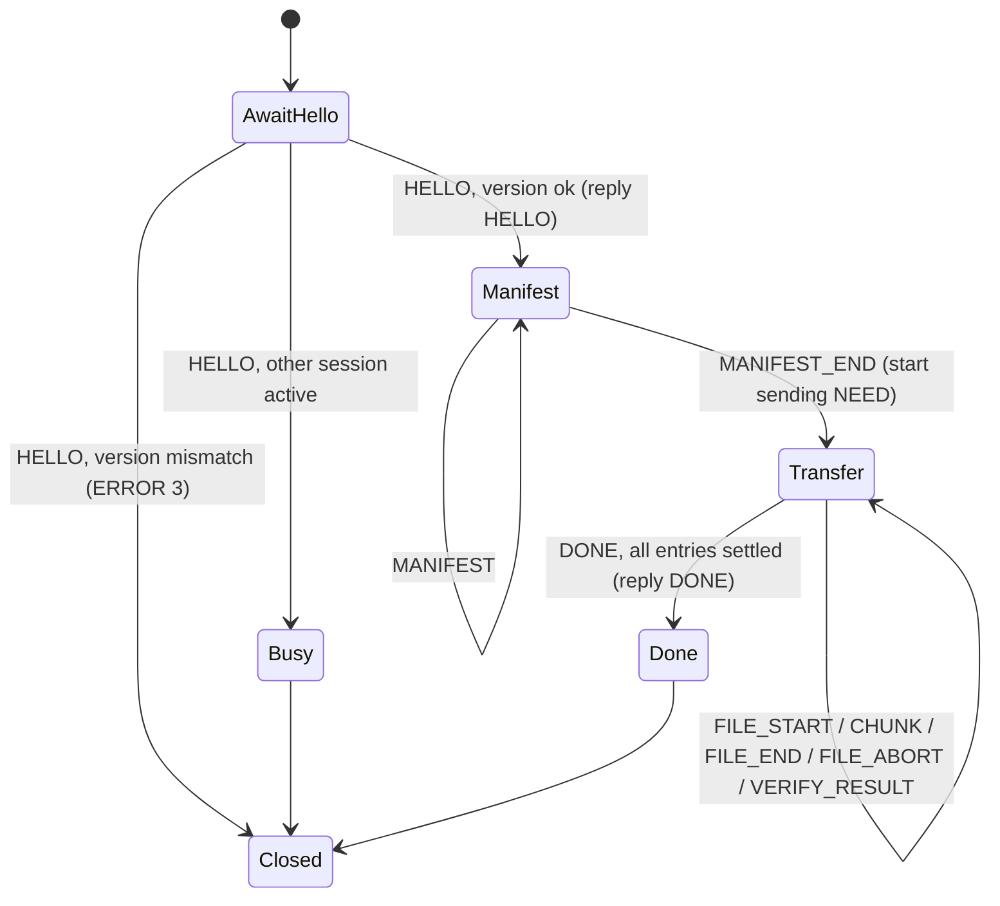
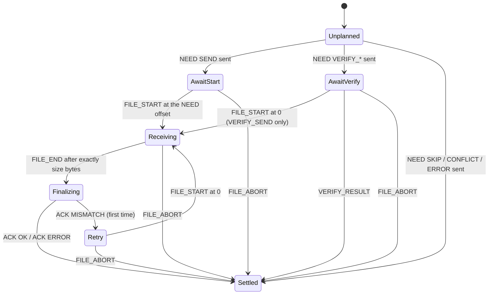

# Transporter wire protocol, version 1

This document specifies the protocol precisely enough for an independent
implementation (DOC-3). The reference implementation is `internal/secure`
(handshake and framing) and `internal/proto` (messages, limits, link). All
integers are **unsigned big-endian** unless stated otherwise.

## 1. Overview

```text
sender (initiator)                                receiver (responder)
  |------------------- TCP connect ------------------->|
  |--- Noise NNpsk0 message 1 (psk, e) --------------->|
  |<-- Noise NNpsk0 message 2 (e, ee) -----------------|   authenticated from here
  |--- HELLO ----------------------------------------->|
  |<-- HELLO (or BUSY, or ERROR) ----------------------|
  |--- MANIFEST ... MANIFEST ... MANIFEST_END -------->|
  |<-- NEED ... NEED (one record per entry) -----------|
  |--- FILE_START, CHUNK..., FILE_END (pipelined) ---->|
  |<-- ACK (one per file, any order) ------------------|
  |--- DONE ------------------------------------------>|
  |<-- DONE (totals) ----------------------------------|
  |--- close ----------------------------------------->|
```

HEARTBEAT may be sent by either side at any time after the handshake, and
ERROR whenever an error must be reported.

## 2. Transport and framing

- TCP. The sender always connects; the receiver always listens.
- Every frame, including the two handshake messages, is:

  ```text
  +----------------+------------------------------+
  | length: uint16 | Noise message (length bytes) |
  +----------------+------------------------------+
  ```

- **Handshake frames**: 1 to 256 bytes (NNpsk0 messages with empty payloads
  are exactly 48 bytes).
- **Transport frames**: the Noise message is a ChaCha20-Poly1305 ciphertext
  of one application message plus a 16-byte tag. Valid lengths are
  **17 to 49,168** (`1 + 16` to `48 KiB + 16`). A receiver of a frame:
  1. reads the 2-byte length;
  2. rejects 0, values below 17 and values above 49,168 **before reading the
     body** (no buffer is ever sized from the peer's value);
  3. reads the body into a fixed buffer and decrypts it with the next
     receive nonce;
  4. on any authentication failure, closes the connection.
- The maximum plaintext (one encoded application message) is
  **49,152 bytes** (48 KiB).

## 3. Handshake

- Noise protocol name: `Noise_NNpsk0_25519_ChaChaPoly_BLAKE2s`.
- Prologue: the 13 ASCII bytes `transporter/1`. A peer with another
  prologue fails the handshake.
- Pre-shared key: 32 bytes, `HKDF-SHA-256(IKM = canonical code, salt =
  empty, info = "transporter v1 psk", L = 32)`. The canonical code is the
  lowercase words joined by single `-` characters (see section 9).
- Message 1 (initiator to responder): tokens `psk, e`, empty payload.
- Message 2 (responder to initiator): tokens `e, ee`, empty payload. Both
  payloads must be empty.
- After message 2, the initiator encrypts with the first cipher state and
  decrypts with the second; the responder does the reverse. Nonces are the
  Noise library's per-direction 64-bit counters; there is no rekeying
  (2^64 - 2 frames per direction is far beyond any transfer).
- The whole handshake must complete within **10 seconds**.
- A responder that cannot decrypt message 1 (wrong key or prologue) sends
  nothing and closes the connection. An initiator that reads a clean EOF
  where message 2 should begin therefore reports an authentication failure.
  Timeouts, resets and truncated frames are network errors.
- Every connection performs a fresh handshake with fresh ephemeral keys.

## 4. Application messages

Each transport frame's plaintext is exactly one message:

```text
+-------------+-----------------------+
| type: uint8 | body (layout by type) |
+-------------+-----------------------+
```

Decoders are strict: bodies must have exactly the specified length (except
the variable parts noted), values outside the stated ranges are rejected,
and trailing bytes are rejected. The encoding of any accepted message is
canonical.

| Type | Name | Body |
| ---: | --- | --- |
| 1 | HELLO | `version u16`, `session_id [16]byte`, `flags u32` |
| 2 | MANIFEST | `count u16` (1 or more), then `count` entries |
| 3 | MANIFEST_END | `count u32`, `total_bytes u64` |
| 4 | NEED | `count u16` (1 or more), then `count` records of 47 bytes |
| 5 | FILE_START | `index u32`, `offset u64` |
| 6 | CHUNK | `index u32`, `offset u64`, `data` (1 to 32,768 bytes: the rest of the message) |
| 7 | FILE_END | `index u32`, `hash [32]byte` |
| 8 | FILE_ABORT | `index u32`, `code u16` |
| 9 | VERIFY_RESULT | `index u32`, `same u8` (0 or 1) |
| 10 | ACK | `index u32`, `status u8`, `code u16` |
| 11 | HEARTBEAT | empty |
| 12 | DONE | `transferred u64`, `bytes u64`, `skipped u64`, `conflicts u64`, `errors u64`, `integrity u64` |
| 13 | ERROR | `code u16`, `fatal u8` (0 or 1), `length u16` (0 to 1024), `message` (UTF-8) |
| 14 | BUSY | empty |

Unknown types are malformed.

### 4.1 HELLO

- `version`: protocol version, **1** for this document.
- `session_id`: 128 random bits chosen by the sender once per run and reused
  on every reconnect. It is not a secret and not a security mechanism; it
  only identifies a continuing session.
- `flags`: bit 0 (`0x1`) is **verify**: compare content hashes instead of
  the quick check. Other bits are reserved (send 0, ignore on receipt).

The receiver echoes the sender's `session_id` and sends its own flags.
Verify is on if either side sets it.

### 4.2 Manifest entries

```text
type u8 | mode u32 | size u64 | mtime_sec i64 | mtime_nsec u32 | path_len u16 | path
```

- `type`: 1 = file, 2 = directory. Other values (symlinks, devices, FIFOs,
  sockets) are malformed.
- `mode`: permission bits; bits outside `0777` are malformed.
- `size`: file size in bytes; must be 0 for directories.
- `mtime_sec`: seconds since the Unix epoch, two's-complement signed.
- `mtime_nsec`: 0 to 999,999,999.
- `path`: 1 to 4096 bytes (see section 7).

Entries are numbered from 0 in the order they arrive, across all MANIFEST
messages of the connection. A MANIFEST batch must fit in one frame. Every
entry's parent directory must be an earlier directory entry, or the root.

`MANIFEST_END.count` must equal the number of entries and
`MANIFEST_END.total_bytes` the sum of file sizes, or the receiver treats it
as a protocol violation.

### 4.3 NEED records

```text
index u32 | action u8 | code u16 | offset u64 | hash [32]byte
```

| Action | Name | Meaning for the sender |
| ---: | --- | --- |
| 0 | SKIP | Already complete (or directory created). Nothing to send. |
| 1 | SEND | Send the file from `offset`. |
| 2 | CONFLICT | The destination differs and will not be overwritten. |
| 3 | ERROR | Per-file error `code`; nothing to send. |
| 4 | VERIFY_SEND | Compare with `hash`; if equal send VERIFY_RESULT(same=1), else send the file from 0. |
| 5 | VERIFY_CONFLICT | Compare with `hash`; send VERIFY_RESULT(same=1 or 0). |

The receiver sends exactly one record per entry, in increasing index order,
in batches of up to 1,045 records. For directories only SKIP and ERROR are
valid. SEND offsets are multiples of 32,768 and at most the file size. Unused
fields are zero.

### 4.4 File data

For each file the receiver asked for, the sender sends `FILE_START(index,
offset)`, then CHUNKs covering exactly `[offset, size)` in order, each
starting where the last ended, then `FILE_END(index, hash)`. `hash` is the
**BLAKE3-256 hash of the whole file**, including any prefix the receiver
already had. Data for a zero-length file is just FILE_START and FILE_END.

The sender does not wait for an ACK before starting the next file
(pipelining). It keeps at most **8 files** between FILE_START and ACK, and
starts a new file only while fewer than **4 MiB** of completed files await
acknowledgment.

If the sender cannot finish a file after FILE_START (or after a SEND or
VERIFY record), it sends `FILE_ABORT(index, code)`. The receiver keeps any
`.part` data and records a per-file error. No ACK follows.

### 4.5 ACK

| Status | Meaning |
| ---: | --- |
| 0 OK | The file was verified and is in place. |
| 1 MISMATCH | The hash did not match; the receiver deleted its partial data. The sender may resend once, from offset 0, with FILE_START(index, 0). |
| 2 ERROR | Per-file failure `code` (for example 7 after a second mismatch, or 18 if a file appeared at the destination). |

ACKs may arrive in any order.

### 4.6 DONE

When every entry is settled and every sent file acknowledged, the sender
sends DONE with all counts zero. The receiver checks that every entry is
settled, replies with DONE carrying its totals, and then waits up to 5
seconds for the sender to close. The sender closes after reading the reply,
and exits successfully only after receiving it.

### 4.7 ERROR

| Code | Meaning | Used in |
| ---: | --- | --- |
| 0 | ok | |
| 1 | internal error | ERROR |
| 2 | protocol violation | ERROR |
| 3 | protocol version mismatch | ERROR |
| 4 | invalid manifest (path, collision, limit) | ERROR |
| 5 | destination not writable | ERROR |
| 6 | destination out of space | ERROR |
| 7 | integrity check failed after retransmission | ACK |
| 8 | I/O error on the receiver | NEED, ACK |
| 9 | sender cannot read the file | FILE_ABORT |
| 10 | file changed on the sender during transfer | FILE_ABORT |
| 11 | directory where a file goes, or the reverse | NEED, ACK |
| 12 | destination path is a symlink (not followed) | NEED, ACK |
| 13 | `NAME.part` is itself in the manifest | NEED |
| 14 | name not valid on the receiving platform | NEED |
| 15 | parent directory could not be created | NEED |
| 16 | peer is shutting down | ERROR |
| 17 | destination path exists and is not a regular file | NEED |
| 18 | destination file appeared during the transfer; not overwritten | ACK |

ERROR with `fatal = 1` ends the session; the sender does not retry, except
for code 16 (the receiver was stopped), which it treats as a network
failure. Messages are informational and must be sanitized before display.

### 4.8 BUSY

Sent by the receiver instead of HELLO when another session has an active
connection. The sender treats it as a transient failure and retries.

## 5. State machines

### 5.1 Receiver, per connection



Per file, inside Transfer:



Any message not allowed by these diagrams is a **protocol violation**: the
receiver sends `ERROR(2, fatal)` and stops. That includes a CHUNK whose
offset is not the next expected one, data beyond the declared size,
FILE_END before all data, an index that is not a file in the manifest, and
more than 8 files in Receiving.

### 5.2 Sender, per connection

AwaitHello (HELLO, BUSY or ERROR) → send manifest → Transfer (NEED, ACK,
ERROR) → after DONE is sent, AwaitDone (DONE). NEED records must arrive
contiguous and in order, with valid actions and offsets; an ACK must refer
to a file awaiting one. Anything else is a protocol violation.

## 6. Liveness

- Each side sends HEARTBEAT if it has sent nothing for **15 s** (checked
  four times per interval).
- Every read and every write has a **45 s** deadline, so a dead peer is
  detected within 45 s even without a TCP error.
- TCP keepalive is enabled on both sides (Go's default, 15 s).

## 7. Paths and limits

Wire paths are relative, UTF-8, `/`-separated, with no empty, `.` or `..`
components, no NUL or backslash, and no leading `/`.

| Limit | Value |
| --- | --- |
| Manifest entries | 1,000,000 |
| Path length | 4,096 bytes |
| Path component length | 255 bytes |
| Message (frame plaintext) | 49,152 bytes |
| CHUNK data | 32,768 bytes |
| ERROR message | 1,024 bytes |
| Files in flight | 8 |
| Acknowledged-pending bytes before starting a new file | 4 MiB |

A receiver also rejects manifests whose paths collide after Unicode NFC
normalization and full case folding (`README` and `readme`, or NFC and NFD
forms of the same name). Receivers on Windows additionally reject, per
entry, names that Windows cannot store (reserved device names, trailing dot
or space, `<>:"|?*`, control characters, drive or UNC prefixes).

## 8. Reconnect and resume

- After any transient failure the sender reconnects (exponential backoff
  with full jitter: base 1 s, factor 2, cap 30 s), performs a new handshake,
  and sends HELLO with the **same** `session_id`, then the same manifest.
- A receiver that still has a connection for that `session_id` closes it
  and serves the new one (supersession). A different `session_id` gets BUSY
  while another connection is active, and is accepted once it has ended.
- The receiver rebuilds its view from the destination directory on every
  connection:
  - A final file with the manifest size and an mtime within 2 s of the
    manifest mtime is complete (quick check). With verify, an equal-size
    file is compared by BLAKE3 hash instead.
  - Partial data lives in `NAME.part` in the same directory. Its size,
    rounded down to a multiple of 32,768, is the resume offset (a `.part`
    longer than the file restarts at 0). The receiver hashes that prefix
    before sending NEED, so the final hash covers the whole file.
  - A verified file is fsynced, given its mode (`& 0777`) and mtime, renamed
    from `NAME.part` to `NAME` atomically, and its directory is synced.
- `.part` files for paths not in the manifest are never touched.

## 9. Pairing code and discovery

- A code is 9 words from a fixed 1,999-word list (`internal/code/
  wordlist.txt`), about 98.7 bits. The canonical form is the lowercase words
  joined with `-`. Parsing accepts any case, any run of `-`, space, `_`,
  `.` or `,`, and any prefix of 4 or more letters (unique in this list).
- mDNS/DNS-SD service type `_transporter._tcp` in `local.`, with TXT records
  `tag=<8 lowercase hex digits>` and `v=1`. The tag is `HKDF-SHA-256(IKM =
  canonical code, salt = empty, info = "transporter v1 discovery", L = 4)`.
  The code itself is never advertised.
- UDP unicast sweep (DISC-6 to DISC-9), used only when mDNS finds nothing.
  The receiver listens on UDP port 29873 (`--sweep-port`), IPv4 only. The
  sender sends each target a probe from one unbound UDP socket:

  ```text
  probe   "TRSQ" | 0x01 | tag (4 bytes) | nonce (8 bytes)       17 bytes
  reply   "TRSR" | 0x01 | nonce (8 bytes) | TCP port (2, BE)    15 bytes
  ```

  `0x01` is the sweep version, the tag is the mDNS tag above, and the nonce
  is random per discovery. A receiver answers only a 17-byte probe with
  its own tag, to the probe's source address, echoing the nonce. The sender
  accepts only a 15-byte reply with its nonce and a non-zero port, and
  connects to the reply's source IP at that port. All other packets are
  ignored without a reply. Probes are sent in batches of 64 with 20 ms
  between batches, and a new round starts every second, for up to 3 s.
